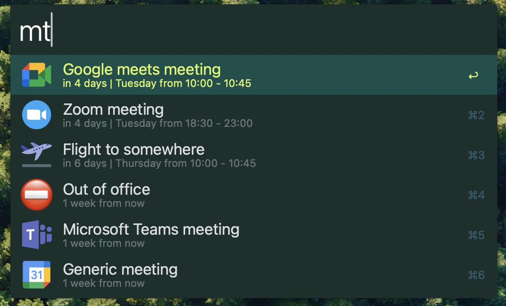

# Meetings Calendar

Jump to slack huddles, zoom rooms and google meets directly from alfred. 

# Setup
- setup your google calendar api access via this [guide](https://developers.google.com/workspace/calendar/api/quickstart/python#set-up-environment)
- save your generated `credentials.json` to this folder
- `make install` to build `.venv/` and create the alfred symlink
- `mcu` in alfred lists your google accounts: pick **Add user** to sign in another one, or pick an account to reauthorize it when its token stops working
- `mcr` reloads the calendar

# Mods
- `⌘` -> show meeting url
- `⌥` -> open event in calendar
- `⌃` -> show start and end times
- `⇧` -> hide this meeting (only this occurrence of a recurring one; delete `hidden.json` to unhide)

# Run
- `alfred://runtrigger/boettner.eric.meetings_calendar/calendar`

# How it runs
- `meetings.jq` reads cached `meetings.json` and recomputes relative subtitles from *now* (so countdown text stays live)
- if the cache is older than 5 minutes, Alfred `rerun`s every second and `alfred.sh` starts a background `meetings.py`
- `cache_time` is a Unix epoch so Python and jq agree on freshness

File cache + live jq is intentional here — Alfred’s native cache would freeze those relative times for the TTL.